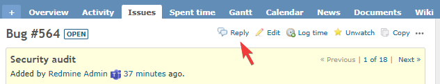
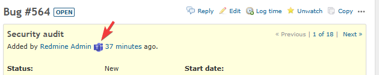
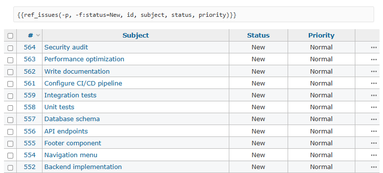
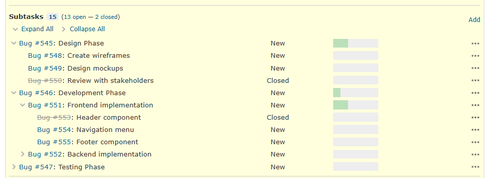
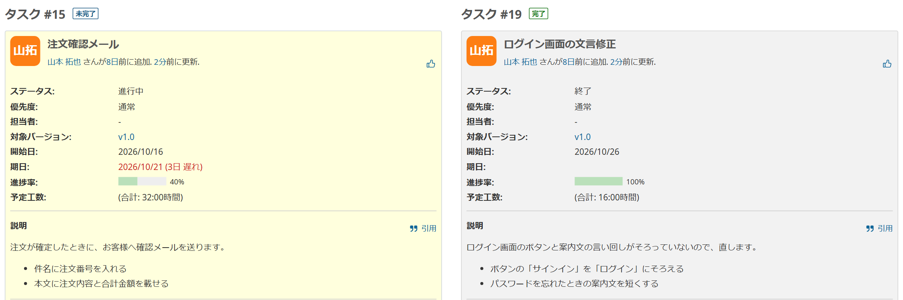

# redmine_studio_plugin

## Overview

This plugin provides features for [Redmine Studio](https://www.redmine-power.com/) (Windows client application provided by Redmine Power).

## Features

- **Reply Button** - Adds a "Reply" button to issues
- **Teams Button** - Adds a "Teams" button to usernames to start a chat
- **Auto Close** - Automatically closes issues based on conditions
- **Date Independent** - Makes parent issue dates independent from child issues
- **Wiki Lists** - Macros to display wiki pages and issue lists
- **Subtask List Accordion** - Adds accordion functionality to the subtask list
- **Journals List** - Displays comment history with status and assignee in the issue list
- **Reply Count** - Displays assignee change count (reply count) in the issue list
- **Children Count** - Displays the number of direct child issues in the issue list
- **Status Background** - Lets you color the issue page to match the issue's status (closed issues in light gray)
- **API** - APIs used internally by Redmine Studio
  - **Plugin API** - Retrieves plugin information
  - **Info API** - Retrieves Redmine environment information
  - **OAuth Client API** - Retrieves the client_id / scopes for browser sign-in (the only anonymously accessible API)
  - **Studio Settings API** - Manages general settings
  - **Activity Info API** - Retrieves activity history
  - **Cache Bundle API** - Completes the Redmine Studio cache update in a single request
  - **Issues Bulk Write API** - Creates/updates multiple issues in a single request
  - **Issues With Extras API** - Returns issue reads with extra fields used by Redmine Studio
  - **Wiki Preview API** - Converts Wiki text to HTML

## Supported Redmine

- V5.x (Tested on V5.1.11)
- V6.x (Tested on V6.1.1)
- V7.x (Tested on V7.0.1)

## Installation

The Redmine installation path varies depending on your environment.
The following instructions use `/var/lib/redmine`.
Please adjust according to your environment.

| Environment | Redmine Path |
|-------------|--------------|
| apt (Debian/Ubuntu) | `/var/lib/redmine` |
| Docker (Official Image) | `/usr/src/redmine` |
| Bitnami | `/opt/bitnami/redmine` |

### 1. Deploy the plugin

Run the following commands in the Redmine plugins folder.

```bash
cd /var/lib/redmine/plugins
git clone https://github.com/RedminePower/redmine_studio_plugin.git
```

### 2. Install

Run the following command. This command removes old plugins, runs DB migration, and registers cron in one step.
Make sure to run this command in the Redmine installation folder.

```bash
cd /var/lib/redmine
bundle exec rake redmine_studio_plugin:install RAILS_ENV=production
```

#### About the cron job

The overdue trigger of Auto Close runs daily at 3:00 via cron. This command registers the job in **the crontab of the user who runs it**.

- Run it as the user that runs Redmine (such as `www-data` or `apache`). Example: `sudo -u www-data bundle exec rake redmine_studio_plugin:install RAILS_ENV=production`
- At the end, it checks whether the registered job can be started under cron. If not, a `WARNING` is shown
- If you have written an Auto Close line for this Redmine in `/etc/crontab` or `/etc/cron.d` yourself, the job is not registered to avoid running twice (the line in the crontab of the user who runs the command is removed)
- If you ran the command before as another user, remove the line left in that user's crontab (check it with `sudo crontab -u <user> -l`)

To check that it works, look at `log/auto_close.log` the next day. Each run adds one line containing `Completed`.

So that the Ruby commands and gems are found under cron, the registered line includes PATH and the gem location settings (such as `GEM_HOME`, only those that are set).

Where crontab is not installed (such as the official Redmine Docker image), the install shows a `WARNING` and the line it would have registered, and continues. To use the overdue trigger of Auto Close, run that line daily yourself. For Docker, you can run it with `docker exec` from cron on the host.

```bash
# Example for the crontab on the host (replace <container> and '...' with the part of the shown line after "0 3 * * *")
0 3 * * * docker exec -u redmine <container> sh -c '...'
```

### 3. Restart Redmine

Restart Redmine to apply the changes.

## Update

### 1. Get the latest version

```bash
cd /var/lib/redmine/plugins/redmine_studio_plugin
git pull
```

### 2. Update

Already-applied steps are skipped, so you can use the same command as for a fresh install.
Run it as the same user as for the install.
A cron line registered by an older version is replaced with the new form (if you changed its time, the time is kept).

```bash
cd /var/lib/redmine
bundle exec rake redmine_studio_plugin:install RAILS_ENV=production
```

### 3. Restart Redmine

Restart Redmine to apply the changes.

## Reply Button

A feature that adds a "Reply" button to issues.



- Clicking the "Reply" button automatically sets the last commenter as the assignee
- If there are no comments, the issue author is set as the assignee
- Enables email-like exchanges on issues, convenient for issue-driven development

For details, see [docs/reply_button-en.md](docs/reply_button-en.md).

## Teams Button

A feature that adds a "Teams" button next to usernames, allowing you to start a chat with one click.



- Clicking the "Teams" button opens a Teams chat with that user
- The chat is pre-filled with issue information (title, URL, issue ID)

For details, see [docs/teams_button-en.md](docs/teams_button-en.md).

## Auto Close

A feature that automatically closes issues (status change, assignee change, comment addition) based on conditions.

- Automatically closes parent issues when all child issues are closed
- Periodically closes expired issues (executed via cron daily at 3:00)
- Flexible condition settings including project, tracker, status, and custom fields

For details, see [docs/auto_close-en.md](docs/auto_close-en.md).

## Date Independent

A feature that makes parent issue start dates and due dates independent from child issues.

Redmine's "Derived from child issues" setting applies system-wide, so you cannot change the behavior per project.
With this feature, you can control synchronization based on specific projects and statuses.

- Make parent issue dates independent for specific projects
- Maintain synchronization for specific statuses (e.g., Closed)

For details, see [docs/date_independent-en.md](docs/date_independent-en.md).

## Wiki Lists

Provides macros to display issue and page lists on Wiki pages.



- `{{wiki_list}}` - Displays a list of wiki pages in table format
- `{{issue_name_link}}` - Creates a link from issue subject
- `{{ref_issues}}` - Displays a list of issues matching conditions (sort order and grouping can also be specified)

For details, see [docs/wiki_lists-en.md](docs/wiki_lists-en.md).

## Subtask List Accordion

Redmine's subtask list becomes difficult to navigate when the hierarchy is deep.
This feature converts the subtask list into an accordion format with collapse/expand functionality, allowing you to display only the parts you need even with complex issue structures.



- Collapse/expand each level of the subtask list
- Adds "Expand All" and "Collapse All" links at the top of the subtask list
- Context menu options: "Expand this tree", "Collapse this tree", "Expand next level all"

For details, see [docs/subtask_list_accordion-en.md](docs/subtask_list_accordion-en.md).

## Journals List

Adds a "Comment History" display option to the issue list. When enabled, a table of comments is displayed below each issue row, allowing you to see at a glance who made what comments.

- Available in both the issue list and the `ref_issues` macro
- Shows status and assignee at each comment's point in time
- Collapse/expand individual comments (with Wiki rendering)
- Sort by column headers, double-click, and right-click context menu for operations

For details, see [docs/journals_list-en.md](docs/journals_list-en.md).

## Reply Count

Displays the number of times an issue's assignee has been changed as "Reply Count". A high reply count may indicate misalignment in requirements or a large number of review comments, serving as a useful metric for analysis.

- Sortable by reply count
- Hover over the reply count to see the assignee change history in a tooltip

For details, see [docs/reply_count-en.md](docs/reply_count-en.md).

## Children Count

Displays the number of direct child issues in the issue list. Useful for quickly identifying issues with many review comments or subtasks.

- Sortable by children count
- Click the count to navigate to a list of child issues
- Hover over the count to see child issue IDs and subjects in a tooltip

For details, see [docs/children_count-en.md](docs/children_count-en.md).

## Status Background

Colors the box with the description and other fields on the issue page to match the issue's status. By default, closed issues stay the same yellow as open ones; when this feature is turned on, issues in a closed status (such as Closed or Rejected) are shown in light gray, so you can see at a glance that they are finished.



Left: an open issue (the usual yellow). Right: a closed issue (light gray).

- Off by default. Installing the plugin does not change the look
- Turn it on in Administration → Plugins → Redmine Studio plugin. Without choosing colors, only closed statuses are shown in light gray
- Colors can also be chosen per status
- The text color does not change, so comments on closed issues stay easy to read

For details, see [docs/status_background-en.md](docs/status_background-en.md).

## API

APIs used internally by Redmine Studio. See the linked documents for details.

**Authentication:** All of the APIs below, **except the OAuth Client API**, require login (authentication) regardless of Redmine's "Authentication required" setting. Unauthenticated requests are rejected (401). Returned content is scoped to each user's permissions and visibility in Redmine. Only the OAuth Client API allows anonymous access, because it is needed before sign-in starts (its response is limited to client_id and scopes).

| API | Description | Details |
|-----|-------------|---------|
| Plugin API | Retrieves plugin information | [docs/plugin_api-en.md](docs/plugin_api-en.md) |
| Info API | Retrieves Redmine environment information | [docs/info_api-en.md](docs/info_api-en.md) |
| OAuth Client API | Retrieves the client_id / scopes for browser sign-in (anonymous access) | [docs/oauth_client_api-en.md](docs/oauth_client_api-en.md) |
| Studio Settings API | Manages general settings | [docs/studio_settings_api-en.md](docs/studio_settings_api-en.md) |
| Activity Info API | Retrieves activity history | [docs/activity_info_api-en.md](docs/activity_info_api-en.md) |
| Cache Bundle API | Retrieves a cache bundle | [docs/cache_bundle_api-en.md](docs/cache_bundle_api-en.md) |
| Issues Bulk Write API | Creates/updates multiple issues in a single request | [docs/issues_bulk_write_api-en.md](docs/issues_bulk_write_api-en.md) |
| Issues With Extras API | Returns issue reads with extra fields used by Redmine Studio | [docs/issues_with_extras_api-en.md](docs/issues_with_extras_api-en.md) |
| Wiki Preview API | Converts Wiki text to HTML | [docs/wiki_preview_api-en.md](docs/wiki_preview_api-en.md) |

## Uninstall

### 1. Run the uninstall command

Removes cron job and rolls back DB migration.
Run it as the same user as for the install. Only the line for this Redmine in that user's crontab is removed. Lines you wrote yourself in `/etc/cron.d` and so on are shown with their location, so remove them manually.

```bash
cd /var/lib/redmine
bundle exec rake redmine_studio_plugin:uninstall RAILS_ENV=production
```

### 2. Remove the plugin

Remove the plugin folder.

```bash
cd /var/lib/redmine/plugins
rm -rf redmine_studio_plugin
```

## License

GPL v2 License

