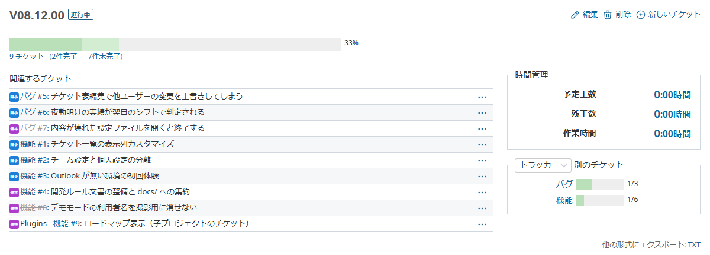
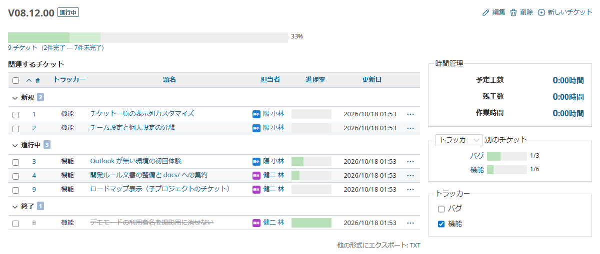
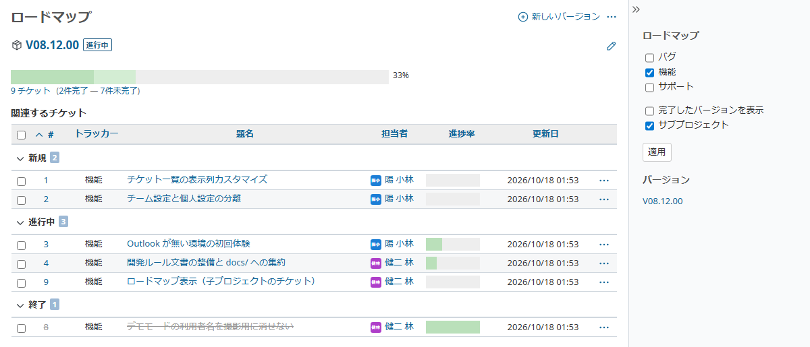
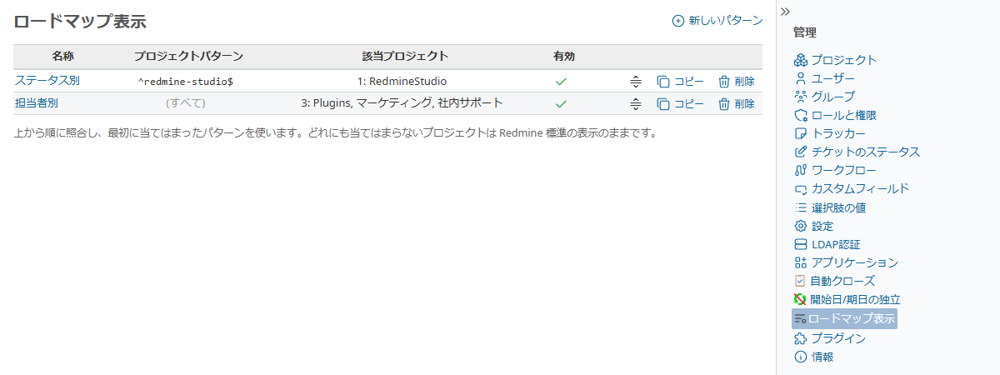
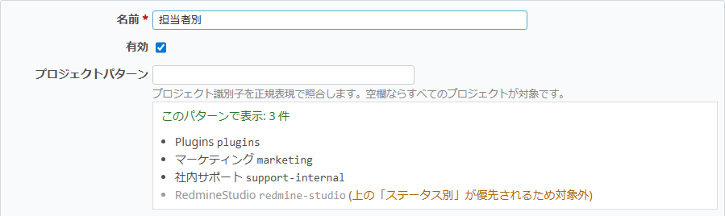
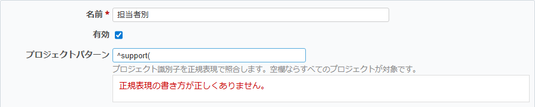
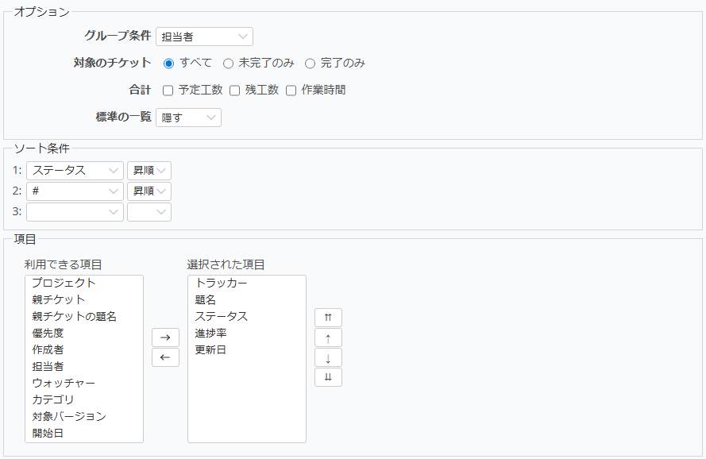
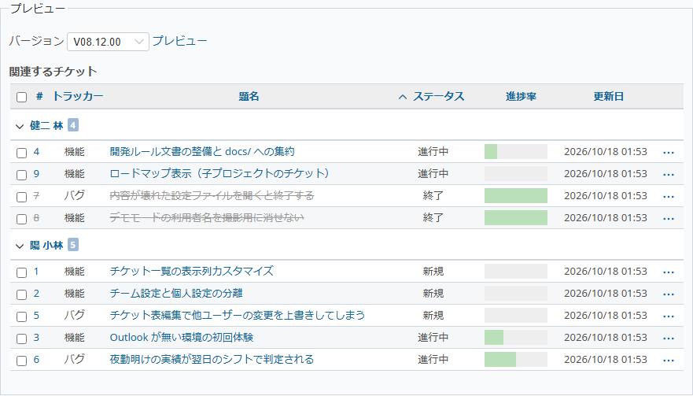
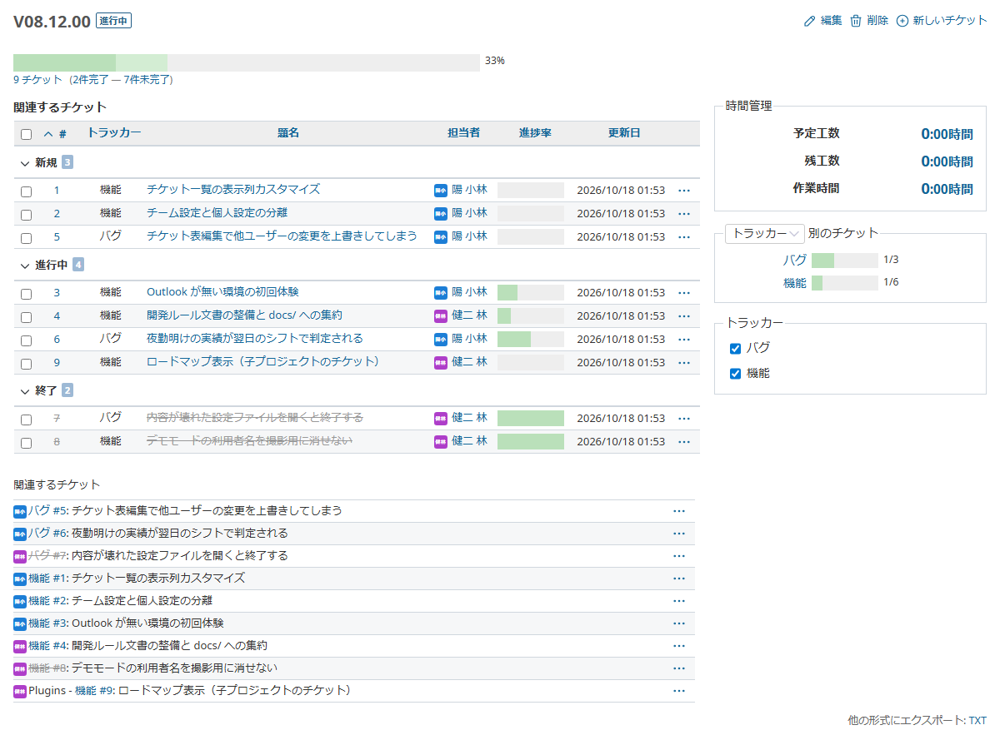

# Roadmap Display

Replaces the "Related issues" list on the roadmap's version page with a list that shows columns such as status, assignee, and % done, grouped by assignee, status, and so on.

## Overview

On Redmine's standard version page, you can only see each issue's subject and whether it is closed.

With this feature, the same place shows a table in the same form as the issue list. Administrators choose which columns to show and how to group them.

- Show columns such as status, assignee, % done, and updated date (any column available in the issue list)
- Group by assignee, status, tracker, and so on, with the number of issues in each group
- Closed issues are struck through, as on the standard roadmap
- Assignees show their avatar under the same conditions as the standard roadmap
- Right-click a row to change status, assignee, and more with the same menu as the issue list
- Click a column header to sort

### Use Cases

- **See release progress at a glance** - Group by status to see how many issues are in progress or closed
- **Find where work is stuck** - Group by assignee and look for issues that have not been updated for a while
- **Use it as is in meetings** - Open the version page to explain the status without rebuilding issue list filters

## Where It Is Shown

### Version Page

The page you open by clicking a version name on the roadmap. "Related issues" is replaced with the configured display.

Check or uncheck trackers in the "Trackers" box on the right to filter the list instantly. The selection is kept in the URL, so you can share or bookmark it.

- Only trackers that actually appear in the version are listed
- All trackers are checked at first (no filtering)
- Sorting by a column header keeps the filter

### Roadmap Page

On the project's "Roadmap" tab (the page listing all versions), each version's list is replaced in the same way.

The tracker and "Subprojects" filters in the sidebar work the same way as for the standard list.

## Administration

Create, edit, and delete display settings (patterns) from "Roadmap display" in the Administration menu.

| Column | Description |
|--------|-------------|
| Name | Name of the pattern |
| Project pattern | Condition for target projects (regular expression). "(all)" when blank |
| Matched projects | Number and names of projects that actually use this pattern |
| Enabled | Whether the pattern is enabled |

Use the right end of each row to reorder (drag the handle), copy, or delete.

### Matching Order

Each project uses only one pattern.

- Patterns are checked **from the top** of the list, and the first pattern whose project pattern matches is used
- Change the order by dragging the handle at the right end of a row
- Projects that match no pattern keep the standard Redmine display
- Disabled patterns are not checked

For example, the screen above works as follows.

| Project | Pattern used |
|---------|--------------|
| RedmineStudio | ステータス別 (matches `^redmine-studio$`) |
| Plugins, マーケティング, 社内サポート | 担当者別 (blank project pattern = all the rest) |

> **Tip:** Put patterns for specific projects at the top, and a pattern with a blank project pattern ("all the rest") at the bottom.

> **Note:** The pattern is decided by the project that the displayed version belongs to. When a parent project's version is shared with subprojects, it is displayed with the parent project's pattern.

## Settings

### Basic Settings

| Setting | Description |
|---------|-------------|
| Name | A descriptive name for management (required) |
| Enabled | Enable or disable the pattern |
| Project pattern | Regular expression matched against the project **identifier**. All projects when blank |

As you type a project pattern, the **projects that will use this pattern** are listed right below it. You can check that the intended projects are targeted before saving.

- Projects that match but are taken by a pattern above are shown in gray as not used
- A warning is shown when no project will use this pattern

An invalid regular expression is shown in red and cannot be saved.

#### Project Pattern Examples

| Pattern | Target |
|---------|--------|
| (blank) | All projects |
| `^support-` | Projects whose identifier starts with `support-` |
| `^(redmine-studio\|plugins)$` | Projects whose identifier is `redmine-studio` or `plugins` |
| `-dev$` | Projects whose identifier ends with `-dev` |

> **Note:** The pattern is matched against the project **identifier, not its name**. You can check the identifier on the project's "Settings" tab.

### List Display

Choose with the same controls as the issue list's "Options", "Sort", and "Columns".

| Setting | Description |
|---------|-------------|
| Group results by | Group by assignee, status, tracker, and so on. No grouping when blank |
| Issues | Choose from "All", "Open only", or "Closed only" |
| Totals | Columns whose totals are shown above the list (estimated time, spent time, and so on) |
| Standard list | Whether to "Hide" Redmine's standard "Related issues" or "Keep below" |
| Sort | Sort order (up to three). When grouped, this is the order within each group |
| Columns | Columns to show and their order |

> **Note:** The "#" (issue number) column is always shown, as in the issue list.

### Preview

Before saving, you can check how a version is displayed with the settings being edited. Select a version and click "Preview".

### Keeping the Standard List

When "Standard list" is set to "Keep below", Redmine's standard "Related issues" is also shown below the configured display.

## Supported Redmine

- Tested on V5.1 / V6.1 / V7.0
- Assignee avatars are shown under the same conditions as the standard roadmap. Redmine 6.0 and later show initials avatars even for users without an image, while Redmine 5.x shows avatars only when Gravatar is enabled
