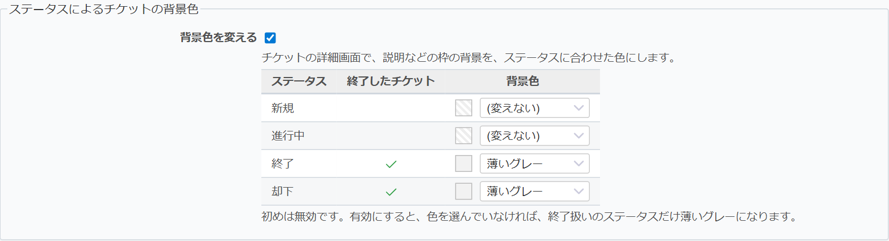

# Status Background (Issue background by status)

Colors the box with the description and other fields on the issue page to match the issue's status.

## Overview

On Redmine's issue page, the box with the description stays the same yellow even when the issue is closed. You cannot tell whether an issue is finished until you read its status field.

When this feature is turned on, issues in a closed status (such as Closed or Rejected) are shown with a light gray background, so you can see at a glance that the issue is finished.

Left: an open issue (the usual yellow). Right: a closed issue (light gray).

Installing the plugin does not change anything by itself (the feature is off by default). Let your users know first, then turn it on as an administrator.

### Main features

- Just turn it on, and issues in a closed status are shown in light gray (no need to choose colors)
- Choose a background color for each status from preset colors (light gray, light blue, light green, light red), or pick any color
- The text color does not change, so comments on closed issues stay easy to read and write
- When an issue is reopened, it takes the color of its new status
- Whether a status is closed follows the status's "Issue closed" setting, not its name, so custom statuses work as they are

## Usage

1. Open Administration → Plugins → "Configure" for Redmine Studio plugin
2. In "Issue background by status", check "Change the background color"
3. If needed, choose a background color for each status
   - "(Do not change)" keeps the original color for that status
   - "Custom color" shows a color picker on the right
4. Click "Apply"

To turn the feature off, uncheck "Change the background color". The colors you chose are kept while it is off.

## Where it applies

Only the issue page. Rows in the issue list are not colored.

The chosen colors have been checked with Redmine's default theme and the farend_basic theme.
