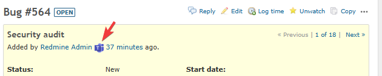

# Teams Button

Adds a "Teams" button next to usernames, enabling one-click chat initiation.

## Overview

This feature adds a "Teams" button next to usernames displayed on issue pages (assignee, author, comment authors, etc.). Clicking the button opens Microsoft Teams chat with pre-filled issue information ready to send.

| Feature | Description |
|---------|-------------|
| Launch Teams Chat | Opens Teams chat using the user's email address |
| Auto-fill Issue Info | Automatically populates the message with issue title, URL, and issue number |

### Use Cases

- Directly chat with an issue's assignee to discuss the issue content
- Ask additional questions or seek clarification from comment authors via chat
- Communicate in real-time while sharing issue information

## Supported Clients

| Requirement | Description |
|-------------|-------------|
| Office365 | Requires a Microsoft 365 (formerly Office 365) license |
| DeepLink Support | Uses DeepLink functionality to launch Teams |

Tested environments:
- Windows 10
- Android

## Enabling the Feature

This feature can be enabled or disabled per project.
The "Teams" button will not appear unless the following settings are configured.

1. Open the project "Settings"
2. In the "Project" tab, check "Teams button" under "Modules" and save

## Behavior

### Auto-filled Message Content

When Teams chat opens, the following content is automatically filled in:

| Line | Content |
|------|---------|
| Line 1 | Issue title |
| Line 2 | Issue URL |
| Line 3 | Issue reference (`refs #issue_number`) |

### Error Handling

An alert dialog displays an error message in the following cases:

- When the user's email address cannot be retrieved ("The email address of this user cannot be retrieved." is shown; the same applies to users not visible to the logged-in user and to locked users)
- When the user hides their email address ("This user does not make their email address public, so a Teams chat cannot be opened." is shown)

As with the Redmine users API, the email address of a user who hides it is returned only to administrators. Administrators can open a Teams chat even with a user who hides their email address.
